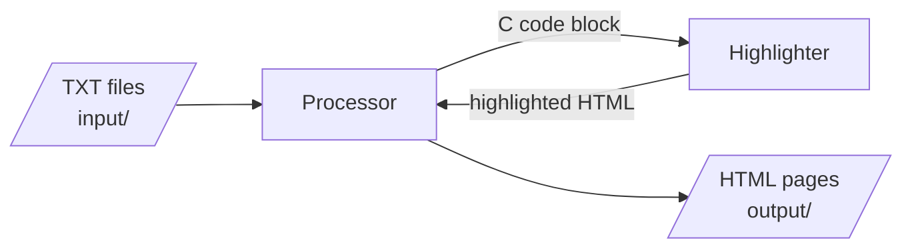
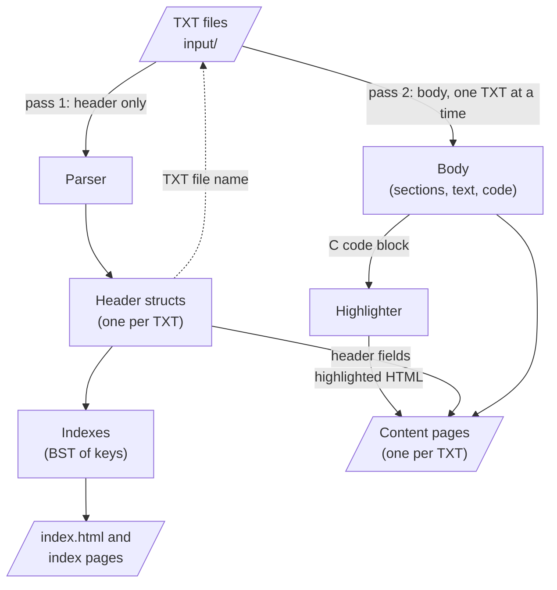
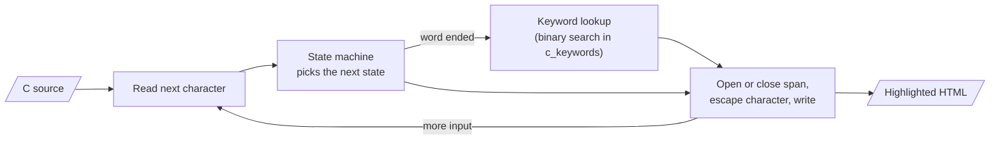
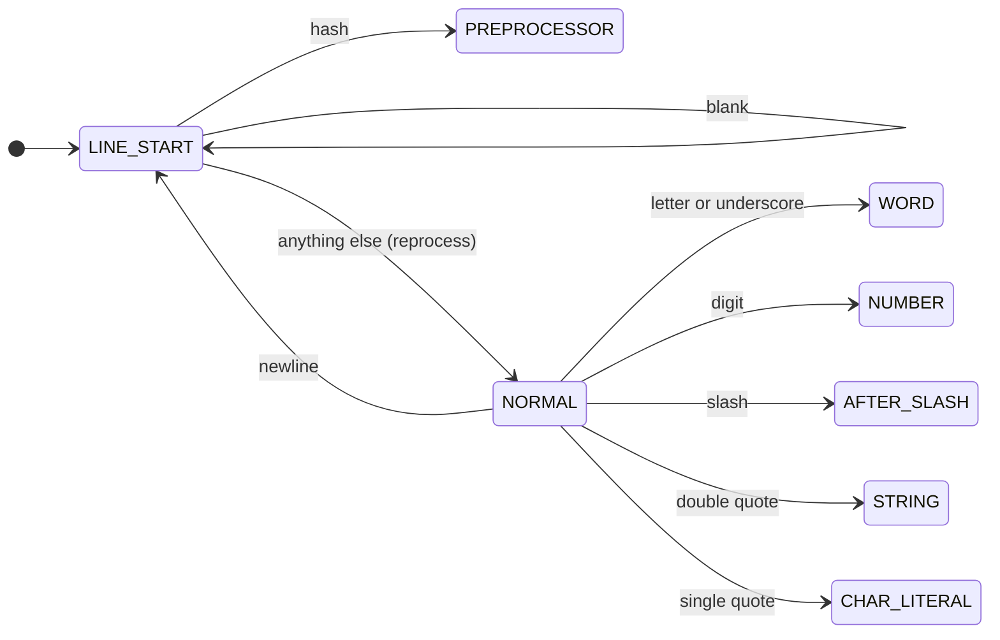
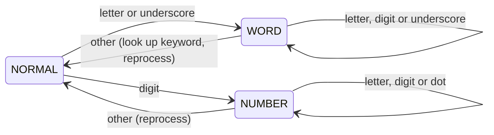
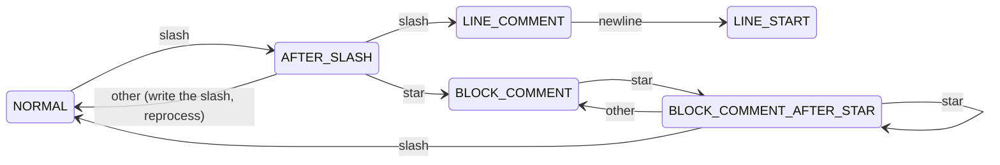
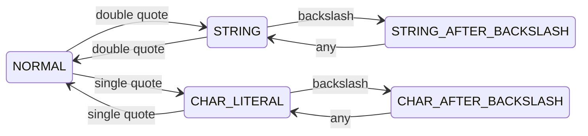
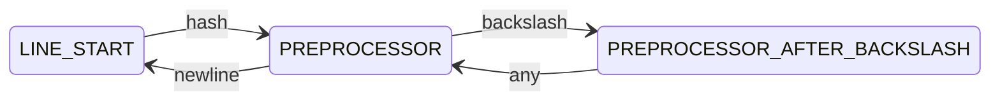

[Português](README.pt-BR.md)

# mac0122

Tools and Solutions for the MAC0122 discipline.

EP1: a C89 program that reads course-content TXT files and generates a
static HTML site, with every C code block syntax-highlighted.

## Basic flow



1. The **processor** reads each TXT file from `input/`.
2. Each C code block in a TXT is sent to the **highlighter**.
3. The highlighter returns the code as highlighted HTML.
4. The processor writes the HTML pages to `output/`.

## Inside the processor



1. **Pass 1.** The parser reads only the header of every TXT and builds
   one header struct per file. Each struct keeps the name of its TXT.
2. **Indexes.** The header structs build the six indexes. Each index
   points to header structs; it never copies them.
3. **Index pages.** `index.html` and the index pages (one per index
   and sort order) are written from the indexes.
4. **Pass 2.** For each header struct, the processor re-opens its TXT,
   skips the header, and reads the body. Code blocks go through the
   highlighter. The content page is written from the header struct (top
   of the page) and the body (the rest), and the body is freed.

## Data model

### Header and body

Each TXT has a header (the lines before `---`) and a body (the rest).
They are handled differently:

- **Header**: read once, in pass 1, into one header struct per TXT.
  The struct holds the header fields (technique, algorithm, authors,
  date, concepts, problem) and the TXT and HTML file names. Authors and
  concepts are lists, since one TXT can name several. Every header
  struct stays in memory until the end of the run.
- **Body**: read in pass 2, one TXT at a time. Pass 2 skips the header
  (it is never parsed twice), writes the page, and frees the body
  before moving on to the next TXT.

Peak memory is therefore every header plus the largest single body.

| Page | Built from |
|---|---|
| `index.html` and the index pages | header structs only, through the indexes |
| one content page per TXT | its header struct (top of the page) and its TXT body (the rest) |

### Indexes

An index maps a key (a concept, an author, ...) to the pages that list
it. Each index is a binary search tree (BST) of keys; each BST node
holds a sorted list of pointers to header structs:

```
            "grafos" ──► [Kruskal, Prim]
           /        \
"arvores" ──► [Kruskal, Prim]    "union-find" ──► [Kruskal]
                                /
                       "heap" ──► [Prim]
```

- Authors and concepts may hold several values; technique, algorithm
  and date hold exactly one. Each value of a multi-value field becomes
  its own key, so one page can appear under several keys.
- Keys are normalized (lowercase, accents stripped) before they are
  compared, so "Árvores" and "árvores" share a node. Index pages show
  the normalized key.
- Dates are written `dd/MM/YYYY` or `YYYY` and are compared by date,
  not as text. A year-only date sorts before every full date in the
  same year (`1956` comes before `12/03/1956`).
- The key of the problem index is the whole normalized problem
  sentence. Pages group under one key only when their TXTs use the same
  sentence. The TXTs are written by the professor, so the format stays
  as it is.
- Indexes point to header structs and never copy them. `main` owns the
  header structs; the indexes only borrow them.
- An in-order walk of the BST lists the keys in order (alphabetical,
  or by date in the date index), which is the order an index page
  needs.

Both directions are stored, key → pages (the list in each BST node)
and page → keys (the author and concept lists in each header struct).
Together, pages and keys therefore form a bipartite graph kept as
adjacency lists, with the BST as the lookup from a key's name to its
node.

### Sorting pages within a key

The reader chooses how the pages under each key are sorted, from links
at the top of the index page.

- The sort orders are the single-valued header attributes: algorithm,
  technique, date and problem. An index does not offer its own
  attribute, since every page under one key has the same value for it
  (the technique index offers algorithm, date and problem).
- Authors and concepts are not offered: a page can hold several of
  them, so it has no single position in the order.
- Each order is a separate, pre-generated page (for example
  `concepts_by_date.html`), so the site needs no JavaScript.
- Ties are broken by TXT file name, which is unique, so every order is
  complete and the same on every run.

## Highlighter

The highlighter is a filter: C source in, highlighted HTML out. It is
used in two ways:

- as a function, called by the processor for each code block;
- as a standalone program in `tools/`, reading standard input and
  writing standard output.

Proposed signature (not yet agreed by the group):

```c
void c_highlighter_write_html(FILE *source_file, FILE *html_file);
```

It streams: it reads one character at a time and keeps only the
current state and the current word, so a code block never has to fit
in memory.

### How it works



1. Read one character from the source.
2. The state machine uses the current state and that character to pick
   the next state.
3. If a word just ended, look it up in the keyword array to decide its
   style.
4. Open or close a `<span>` when the style changes, escape the
   character for HTML, and write it.
5. Repeat until the end of input, then close any open span.

### State machine

The highlighter is a finite state machine. The current state says what
the reader is inside of (a string, a comment, ...); some characters
move it to another state. Entering a styled state opens a
`<span class="...">`; leaving it closes the span.

Constructs that need two characters (`/*`, `*/`, `//`, `\"`) use
in-between states ("just saw a slash", "just saw a star") instead of
peeking at the next character.

The machine is drawn in five parts below. In every part, a transition
that is not drawn keeps the current state and writes the character as
it is. "Reprocess" means the character that ended a state is not
consumed: the next state handles it again. For example, in `x+1` the
`+` ends the word `x` and is then written by `NORMAL`.

#### 1. Line start and normal code

Every construct starts from here.



`LINE_START` exists for the preprocessor: `#` starts a directive only
when it is the first non-blank character of a line.

#### 2. Words and numbers



A letter only says that a word starts. `WORD` collects the letters;
when the word ends, a binary search in the sorted keyword array
(`c_keywords`) decides its style. The keyword set is fixed, so a sorted
array fits better than a BST.

#### 3. Comments



A lone `/` is division, so `AFTER_SLASH` waits one character before
deciding. `//` comments are handled even though this project is C89:
the code blocks in the TXTs are the professor's, not ours.

#### 4. Strings and character literals



The `*_AFTER_BACKSLASH` states skip one escaped character, so `\"`
does not end a string and `'\''` is one character literal.

#### 5. Preprocessor directives



A backslash before a newline continues the directive on the next line.

#### Styles

| State | Style |
|---|---|
| `LINE_START`, `NORMAL`, `AFTER_SLASH` | none |
| `WORD` | keyword if the word is a C reserved word, else none |
| `NUMBER` | number |
| `STRING`, `STRING_AFTER_BACKSLASH`, `CHAR_LITERAL`, `CHAR_AFTER_BACKSLASH` | string |
| `LINE_COMMENT`, `BLOCK_COMMENT`, `BLOCK_COMMENT_AFTER_STAR` | comment |
| `PREPROCESSOR`, `PREPROCESSOR_AFTER_BACKSLASH` | preprocessor |

- **Every character written goes through the shared HTML escape**
  (`<`, `>`, `&`), inside strings and comments too.
- **At end of input**, an open span is closed, so an unterminated
  string or comment still produces valid HTML.

## Future work

- Graph view of the site: pages and keys as nodes, linked when a page
  lists a key. The data model above already holds this graph; only
  drawing it is missing. Not part of phase 1.
