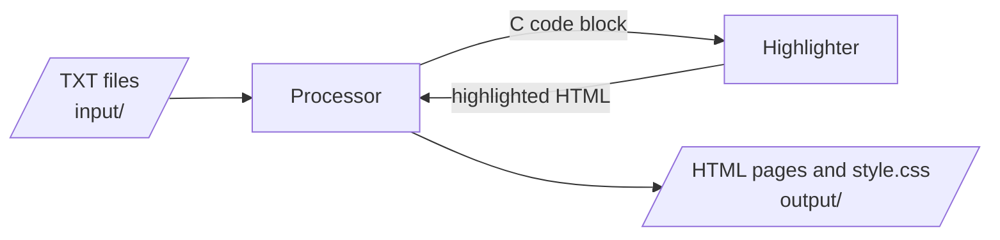
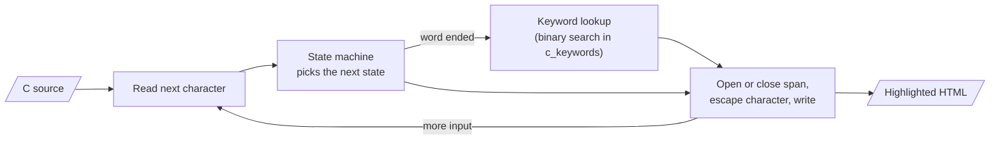
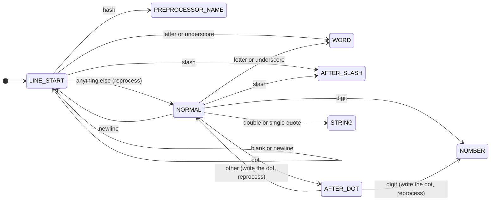
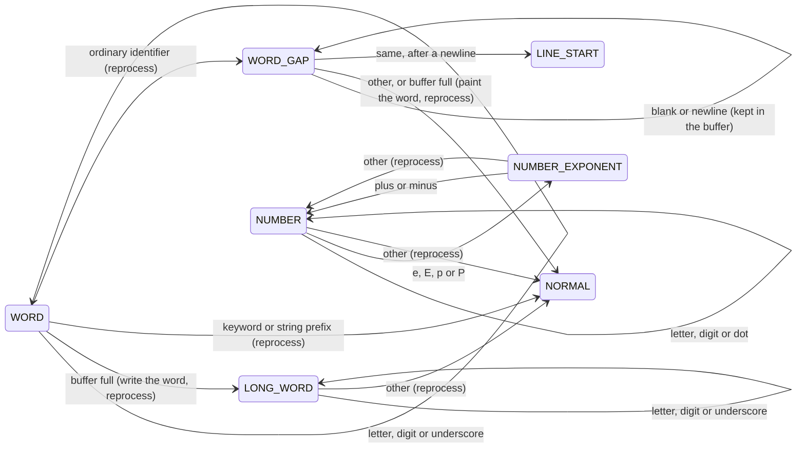
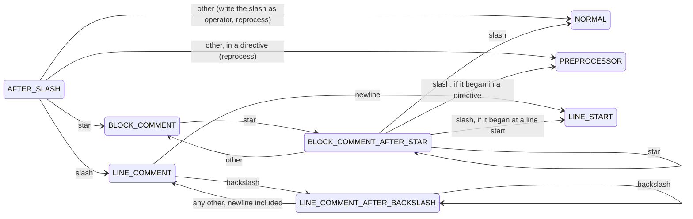
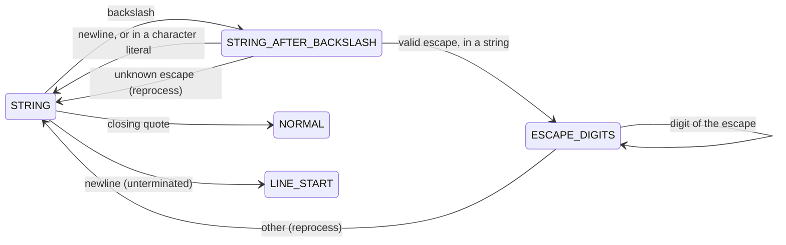
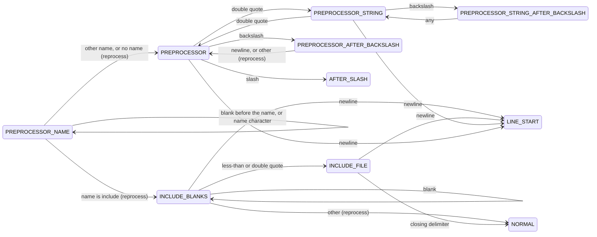

[Português](README.pt-BR.md)

# mac0122

Tools and Solutions for the MAC0122 discipline.

EP1: a C89 program that reads course-content TXT files and generates a
static HTML site, with every C code block syntax-highlighted.

## Running

From the repository root, with the TXTs given as arguments:

```
gcc -std=c89 -Wall -Wextra -pedantic -Werror src/*.c -o ep1
./ep1 input/*.txt
```

The site is written to `output/`, which must exist and is not committed.
`template.txt` shows the format and is never a page, wherever it is. The
program reports a TXT that does not fit the format (it cannot be opened,
has no `---` line, or has an invalid `Data`) or whose page name is taken,
and then stops with status 1 before writing any page.

## Visual design

The site's look (palette, type, page anatomy) is recorded in
[DESIGN.md](DESIGN.md), and the product facts it serves (audience,
constraints, what the site may and may not show) in
[PRODUCT.md](PRODUCT.md). The CSS itself is written by `html.c`.

## Basic flow



1. The **processor** reads each TXT file from `input/`.
2. Each C code block in a TXT is sent to the **highlighter**.
3. The highlighter returns the code as highlighted HTML.
4. The processor writes the HTML pages and one shared `style.css` to
   `output/`.

## Inside the processor

```mermaid
flowchart TD
    txt[/"TXT files<br/>input/"/] -- "pass 1: header only" --> parser["Parser"]
    parser --> headers["Header structs<br/>(one per TXT)"]
    headers --> indexes["Indexes<br/>(BST of keys)"]
    indexes --> index_pages[/"index.html and<br/>index pages"/]
    indexes --> graph["Graph<br/>(pages and keys)"]
    graph --> graph_pages[/"graph pages"/]
    headers -. "TXT file name" .-> txt
    txt -- "pass 2: body, one TXT at a time" --> body["Body<br/>(sections, text, code)"]
    body -- "C code block" --> highlighter["Highlighter"]
    highlighter -- "highlighted HTML" --> content_pages
    headers -- "header fields" --> content_pages[/"Content pages<br/>(one per TXT)"/]
    body --> content_pages
```

1. **Pass 1.** The parser reads only the header of every TXT and builds
   one header struct per file. Each struct keeps the name of its TXT.
2. **Indexes.** The header structs build the six indexes. Each index
   points to header structs; it never copies them.
3. **Index pages.** `index.html` and the index pages (one per index
   and sort order) are written from the indexes. The graph of pages and
   keys is built from the indexes, laid out, and written as the graph
   pages (see [Graph view](#graph-view)).
4. **Pass 2.** For each header struct, the processor re-opens its TXT,
   skips the header, and reads the body. Code blocks go through the
   highlighter. The content page is written from the header struct (top
   of the page) and the body (the rest), and the body is freed.
   References are collected at the end of the page, wherever they appear
   in the TXT.

## Data model

### Header and body

Each TXT has a header (the lines before `---`) and a body (the rest).
They are handled differently:

- **Header**: read once, in pass 1, into one header struct per TXT.
  The struct holds the header fields (technique, algorithm, authors,
  date, concepts, problem) and the TXT and HTML file names. Authors and
  concepts are lists, since one TXT can name several. Every header
  struct stays in memory until the end of the run.
- **Body**: read in pass 2, one TXT at a time. Pass 2 skips the header
  (it is never parsed twice), writes the page, and frees the body
  before moving on to the next TXT.

Peak memory is therefore every header plus the largest single body.

| Page | Built from |
|---|---|
| `index.html` and the index pages | header structs only, through the indexes |
| one content page per TXT | its header struct (top of the page) and its TXT body (the rest) |

### Indexes

An index maps a key (a concept, an author, ...) to the pages that list
it. Each index is a binary search tree (BST) of keys; each BST node
holds a sorted list of pointers to header structs:

```
            "grafos" ──► [Kruskal, Prim]
           /        \
"arvores" ──► [Kruskal, Prim]    "union-find" ──► [Kruskal]
                                /
                       "heap" ──► [Prim]
```

- Authors and concepts may hold several values; technique, algorithm
  and date hold exactly one. Each value of a multi-value field becomes
  its own key, so one page can appear under several keys.
- Keys are normalized (lowercase, accents stripped) before they are
  compared, so "Árvores" and "árvores" share a node, and anchors are
  built from the normalized key. Index pages show the key as the first
  TXT, in file-name order, spells it, with its first letter capitalized
  (by CSS); the BST node keeps that spelling. The TXTs are UTF-8, and pages declare that charset.
- Dates are written `dd/MM/YYYY` or `YYYY` and are compared by date,
  not as text. A year-only date sorts before every full date in the
  same year (`1956` comes before `12/03/1956`).
- The key of the problem index is the whole normalized problem
  sentence. Pages group under one key only when their TXTs use the same
  sentence. The TXTs are written by the professor, so the format stays
  as it is.
- Indexes point to header structs and never copy them. `main` owns the
  header structs; the indexes only borrow them.
- An in-order walk of the BST lists the keys in order (alphabetical,
  or by date in the date index), which is the order an index page
  needs.

Both directions are stored, key → pages (the list in each BST node)
and page → keys (the author and concept lists in each header struct).
Together, pages and keys therefore form a bipartite graph kept as
adjacency lists, with the BST as the lookup from a key's name to its
node.

### Sorting pages within a key

The reader chooses how the pages under each key are sorted, from links
at the top of the index page.

- The sort orders are the single-valued header attributes: algorithm,
  technique, date and problem. An index does not offer its own
  attribute, since every page under one key has the same value for it
  (the technique index offers algorithm, date and problem).
- Authors and concepts are not offered: a page can hold several of
  them, so it has no single position in the order.
- Each order is a separate, pre-generated page (for example
  `concepts_by_date.html`), so the site needs no JavaScript.
- A page with no value for the attribute comes after those that have
  one.
- Ties are broken by TXT file name, which is unique, so every order is
  complete and the same on every run.
- A node's list is sorted by TXT file name. Each order is built as a
  temporary list only while its table is written, so a node keeps one
  list, however many orders the site offers.
- Each index opens by algorithm, and the algorithm index by technique.
  Content pages link each author and concept to its key there.

## Highlighter

The highlighter is a filter: C source in, highlighted HTML out. It is
used in two ways:

- as a function, called by the processor for each code block;
- as a standalone program, `tools/c_filter.c`, reading a file or
  standard input and writing standard output.

The interface:

```c
void c_highlighter_write_html(FILE *source_file, FILE *html_file);
void c_highlighter_write_html_from_text(const char *source_text, FILE *html_file);
void c_highlighter_write_css(FILE *css_file);
void c_highlighter_write_head_styles(FILE *html_file, int has_page_style);
```

The processor holds each code block in memory, as part of the body, so it
uses `c_highlighter_write_html_from_text`; `c_filter` reads a file. Both
run the same state machine and give the same HTML.

The site has one shared `style.css`, written with
`c_highlighter_write_css` followed by the site's rules: layout, and a
white background on every page and code block, the background the code
colors were chosen for. Every page links it with
`c_highlighter_write_head_styles`. A style present on a page takes
priority over the shared sheet: the browser lets the later of two equal
rules win, so any `<style>` block comes after the link. Rules the page
does not repeat still come from the shared sheet.

`c_filter` writes a page with its own copy of the styles, so it works
without `style.css`; `-s` writes a page styled only by `style.css`, and
`-c` writes that file.

It streams: it reads one character at a time and keeps only the current
state, a few small variables and one word buffer, so a code block never
has to fit in memory. Carriage returns are dropped, so Windows files
give the same HTML.

Every source line is written as `<span class="l">...</span>`, and the
CSS draws the line number with a counter, so the number is not copied
with the code. A style span is opened only when a character is written,
and is closed and reopened at every newline, so adjacent characters with
the same style share one span.

### How it works



1. Read one character from the source.
2. The state machine uses the current state and that character to pick
   the next state.
3. If a word just ended, look it up in the keyword array to decide its
   style.
4. Open or close a `<span>` when the style changes, escape the
   character for HTML, and write it.
5. Repeat until the end of input, then close any open span and line.

### State machine

The highlighter is a finite state machine of 23 states, drawn in five
parts. A transition that is not drawn keeps the current state. Style
does not depend on the state alone: see [Styles](#styles).

"Reprocess" means the character that ended a state is not consumed: the
next state handles it again. End of input is handled like any other
character by the states still holding unwritten characters (`WORD`,
`WORD_GAP`, `AFTER_DOT`, `AFTER_SLASH`, `STRING_AFTER_BACKSLASH`,
`PREPROCESSOR_AFTER_BACKSLASH`), so they flush; the others just stop.

Besides the state, the machine keeps:

| Variable | Meaning |
|---|---|
| `buffer` | the current word and the blanks after it (256 bytes) |
| `brace_depth` | how many `{` are open, which tells a definition from a call |
| `previous_token` | the last significant token: type-like, `struct` or `union`, statement boundary, or other |
| `does_word_start_line` | no other token came before this word on its line |
| `does_gap_have_newline` | the blanks after the word held a newline |
| `state_after_comment` | where a block comment returns to |
| `delimiter` | the closing character of the current string or file name |
| `escape_digits_left`, `is_escape_octal` | how many digits, and which ones, the current escape still takes |

#### 1. Line start and normal code



`LINE_START` exists for the preprocessor (`#` starts a directive only
as the first token of a line) and for labels (`end:` is a label only as
the first word of a line). Comments do not count as tokens here, so a
block comment that began at a line start returns to `LINE_START`.
Operators (`~ ! % ^ & * + = | ? : < > -`) are written in `NORMAL` with
the operator style; `( ) [ ] { } , ; .` stay plain. `{` and `}` change
the brace depth.

#### 2. Words and numbers



When a word ends, a binary search in the sorted keyword array
(`c_keywords`) decides whether it is a keyword and which style it gets.
The keyword set is fixed, so a sorted array fits better than a BST. The
string prefixes `L`, `u`, `U` and `u8` count only when a quote ended
them.

An ordinary identifier is painted only when the next significant
character is known, so `WORD_GAP` holds the word and the blanks after
it in the same buffer:

- at brace depth 0, followed by `(`, after a type-like token or a
  statement boundary: function name;
- after `struct` or `union`, followed by `{`: structure name;
- first word of a line, inside braces, after a statement boundary,
  followed by `:`: label (the colon is written plain).

A statement boundary is the start of the input, a directive, or one of
`; { } ) :`. A word that does not fit in the buffer cannot be a keyword,
so `LONG_WORD` writes it without style.

#### 3. Comments



A lone `/` is division, so `AFTER_SLASH` waits one character before
deciding. `//` comments are handled even though this project is C89:
the code blocks in the TXTs are the professor's, not ours. A backslash
before a newline continues a `//` comment on the next line.

#### 4. Strings and character literals



Strings and character literals share these states; the closing quote
is the stored delimiter. In a string, escapes get their own style, and
`ESCAPE_DIGITS` extends it over `\x41`, `\101` and `\u00e9`. In a
character literal the whole literal has the string style. A backslash
before a newline continues the string; a newline alone ends it.

#### 5. Preprocessor directives



For `#include`, only the directive word has the preprocessor style; the
file name has its own style and the rest of the line is normal code. For
any other directive, the whole line has the preprocessor style, up to a
comment. A backslash before a newline continues the directive.
`PREPROCESSOR_STRING` keeps `"http://x"` from starting a comment.

#### Styles

| Style (CSS class) | Used for | Example |
|---|---|---|
| `pragma` | directive line, or only `#include` | `#define MAX 100` |
| `arquivo` | file name after `#include` | `<stdio.h>` |
| `coment` | `//` and `/* */` comments | `// text` |
| `tipo` | type words | `int`, `size_t`, `FILE` |
| `comando` | other reserved words | `if`, `struct`, `static` |
| `builtin` | language constants | `NULL`, `true`, `false` |
| `funcao` | function name in a definition or prototype, not in a call | `soma` in `int soma(int n)` |
| `estrutura` | name in `struct NAME {` and `union NAME {` | `ponto` in `struct ponto {` |
| `rotulo` | label definition, not `goto end` | `end` in `end:` |
| `string` | strings, character literals, prefixes | `"text"`, `'c'`, `L"x"` |
| `escape` | escape sequences inside strings | `\n`, `\x41` |
| `numero` | numeric literals | `42`, `0x1F`, `1e-3` |
| `operador` | operators | `+`, `==`, `:` |

- **Every character written goes through the shared HTML escape**
  (`<`, `>`, `&`), inside strings and comments too.
- **At end of input**, an open span and an open line are closed, so an
  unterminated string or comment still produces valid HTML.

#### Known limits

Accepted to keep the machine small:

- A top-level macro call such as `DECLARE(x);` looks like a function
  name, because the machine cannot see past the `)`.
- In `int foo /* c */ (void)`, `foo` is not a function name, because the
  comment ends the gap.
- `void f(void), g(void);` paints only `f`.
- `0xE+1` is one number. C's own preprocessing-number rule reads it the
  same way.
- A `"` in a character literal in a directive (`#define Q '"'`) opens
  `PREPROCESSOR_STRING`, so a comment later on that line keeps the
  directive's style.
- Braces in `#if` branches all count towards `brace_depth`.

## Graph view

The "Grafo" tab draws the bipartite graph of the data model as inline
SVG, with no JavaScript. `graph.c` builds and lays out the graph;
`html.c` writes it.

- **Nodes and edges.** Every page, and every key of five indexes; an edge
  joins a page to each key it lists. Algorithm keys are left out: an
  algorithm key names its own page, so it would draw every page twice.
  Node ids put pages first, in TXT file-name order, then each index's
  keys in key order, so ids never depend on the order of the arguments.
- **Global view (`graph.html`).** A force-directed layout
  (Fruchterman–Reingold): pages start on an inner circle and keys on an
  outer one, then every pair repels and every edge pulls for a fixed
  number of steps while the allowed movement cools to zero. Date nodes
  stay out of the forces and are placed beside their pages at the end,
  since they start hidden and seldom join two pages. Checkboxes before
  the drawing hide each node type through CSS (`:checked`).
- **Local views (`graph_local.html`, `local_*.html`).** One page per
  node: the node in the centre, its neighbours on a first ring, and
  their neighbours on a second ring, each ring evenly spaced in id
  order. `graph_local.html` lists them all, by type; each content page
  links its own as "Ver no grafo". Local pages are named
  `local_page_<page>.html` and `local_<index>_<n>.html`, where `n` is
  the key's position in key order; `local_` names are reserved.
- **Interaction without JavaScript.** Each node is an SVG link to the
  real page (a content page, or the key's section on its index page),
  with a `<title>` as tooltip and accessible name. Hovering or focusing a
  node highlights its edges and neighbours through one generated
  `:has()` rule per node.
- **Same output on every run.** The layout uses its own square root,
  sine and cosine instead of `<math.h>` (so the build needs no `-lm` and
  no math library can change a coordinate), a fixed start and a fixed
  number of steps, and coordinates are rounded to integers.
- **Memory.** The whole graph holds only ids and borrowed pointers into
  the headers and indexes. Local graphs are built, written and freed one
  at a time.
