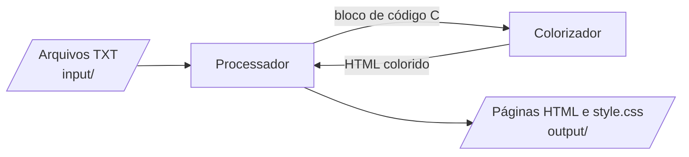
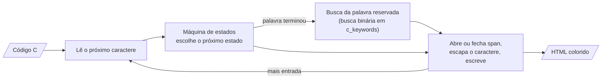
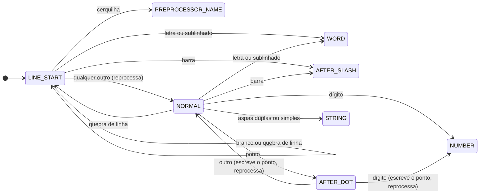
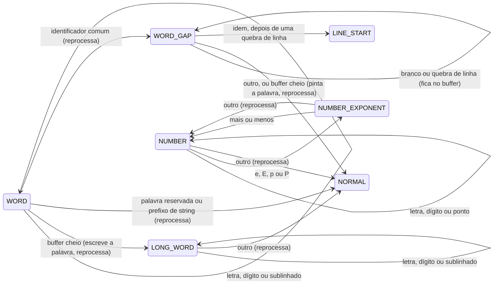
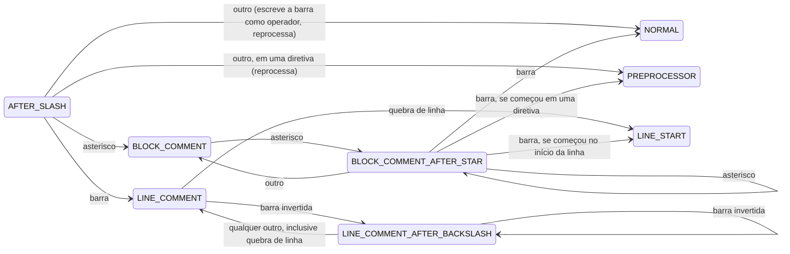
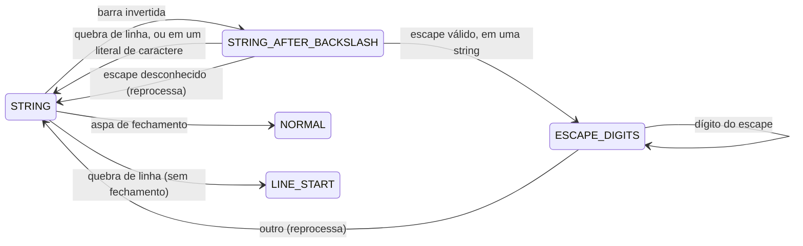
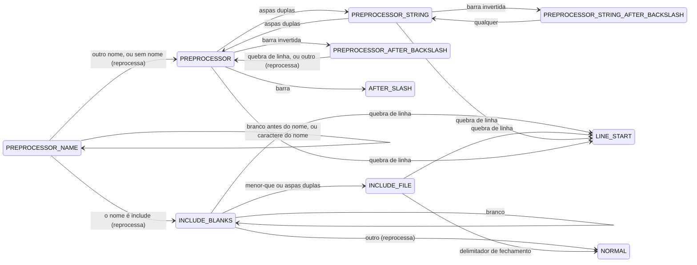

[English](README.md)

# mac0122

Ferramentas e soluções para a disciplina MAC0122.

EP1: um programa em C89 que lê arquivos TXT com o conteúdo da
disciplina e gera um site HTML estático, com cada bloco de código C
destacado (*syntax highlighting*).

## Como executar

Na raiz do repositório, com os TXTs como argumentos:

```
gcc -std=c89 -Wall -Wextra -pedantic -Werror src/*.c -o ep1
./ep1 input/*.txt
```

O site é escrito em `output/`, que precisa existir e não vai para o
repositório. `template.txt` mostra o formato e nunca vira página, esteja
onde estiver. O programa informa um TXT que não segue o formato (não abre,
não tem a linha `---` ou tem um `Data` inválido) ou cujo nome de página já
está em uso, e então termina com status 1 antes de escrever qualquer página.

## Design visual

A aparência do site (paleta, tipografia, anatomia das páginas) está
registrada em [DESIGN.md](DESIGN.md), e os fatos do produto que ela atende
(público, restrições, o que o site pode e não pode mostrar) em
[PRODUCT.md](PRODUCT.md), ambos em inglês. O CSS em si é escrito pelo
`html.c`.

## Fluxo básico



1. O **processador** lê cada arquivo TXT de `input/`.
2. Cada bloco de código C de um TXT é enviado ao **colorizador**.
3. O colorizador devolve o código como HTML colorido.
4. O processador grava as páginas HTML e um `style.css` compartilhado em
   `output/`.

## Dentro do processador

```mermaid
flowchart TD
    txt[/"Arquivos TXT<br/>input/"/] -- "passada 1: só o cabeçalho" --> parser["Parser"]
    parser --> headers["Structs de cabeçalho<br/>(uma por TXT)"]
    headers --> indexes["Índices<br/>(BST de chaves)"]
    indexes --> index_pages[/"páginas de índice<br/>e sobre.html"/]
    indexes --> graph["Grafo<br/>(páginas e chaves)"]
    graph --> graph_pages[/"index.html e<br/>grafos locais"/]
    headers -. "nome do TXT" .-> txt
    txt -- "passada 2: corpo, um TXT por vez" --> body["Corpo<br/>(seções, texto, código)"]
    body -- "bloco de código C" --> highlighter["Colorizador"]
    highlighter -- "HTML colorido" --> content_pages
    headers -- "campos do cabeçalho" --> content_pages[/"Páginas de conteúdo<br/>(uma por TXT)"/]
    body --> content_pages
```

1. **Passada 1.** O parser lê apenas o cabeçalho de cada TXT e monta
   uma struct de cabeçalho por arquivo. Cada struct guarda o nome do
   seu TXT.
2. **Índices.** As structs de cabeçalho montam os seis índices. Cada
   índice aponta para structs de cabeçalho; nunca as copia.
3. **Páginas de índice.** As páginas de índice (uma por índice e
   ordenação) são geradas a partir dos índices, junto com `sobre.html`.
   O grafo de páginas e chaves é montado a partir dos índices,
   posicionado e escrito em `index.html` (a página inicial) e nas páginas
   de grafo local (veja [Visualização em grafo](#visualização-em-grafo)).
4. **Passada 2.** Para cada struct de cabeçalho, o processador reabre o
   seu TXT, pula o cabeçalho e lê o corpo. Os blocos de código passam
   pelo colorizador. A página de conteúdo é gerada a partir da struct
   de cabeçalho (topo da página) e do corpo (o restante), e o corpo é
   liberado. As referências são reunidas no fim da página, onde quer que
   apareçam no TXT.

## Modelo de dados

### Cabeçalho e corpo

Cada TXT tem um cabeçalho (as linhas antes de `---`) e um corpo (o
restante). Eles são tratados de formas diferentes:

- **Cabeçalho**: lido uma única vez, na passada 1, para uma struct de
  cabeçalho por TXT. A struct guarda os campos do cabeçalho (técnica,
  algoritmo, autores, data, conceitos, problema) e os nomes do TXT e do
  HTML. Autores e conceitos são listas, pois um TXT pode citar vários.
  Todas as structs de cabeçalho ficam na memória até o fim da execução.
- **Corpo**: lido na passada 2, um TXT por vez. A passada 2 pula o
  cabeçalho (ele nunca é lido duas vezes), gera a página e libera o
  corpo antes de passar para o próximo TXT.

O pico de memória é, portanto, todos os cabeçalhos mais o maior corpo.

| Página | Gerada a partir de |
|---|---|
| `index.html` e as páginas de índice | só as structs de cabeçalho, por meio dos índices |
| uma página de conteúdo por TXT | sua struct de cabeçalho (topo da página) e o corpo do seu TXT (o restante) |

### Índices

Um índice associa uma chave (um conceito, um autor, ...) às páginas
que a citam. Cada índice é uma árvore binária de busca (BST) de
chaves; cada nó da BST guarda uma lista ordenada de ponteiros para
structs de cabeçalho:

```
            "grafos" ──► [Kruskal, Prim]
           /        \
"arvores" ──► [Kruskal, Prim]    "union-find" ──► [Kruskal]
                                /
                       "heap" ──► [Prim]
```

- Autores e conceitos podem ter vários valores; técnica, algoritmo e
  data têm exatamente um. Cada valor de um campo com vários valores
  vira uma chave própria, então uma página pode aparecer sob várias
  chaves.
- As chaves são normalizadas (minúsculas, sem acentos) antes de serem
  comparadas, então "Árvores" e "árvores" ficam no mesmo nó, e as
  âncoras são feitas da chave normalizada. As páginas de índice mostram
  a chave como o primeiro TXT, na ordem dos nomes de arquivo, a escreve,
  com a primeira letra maiúscula (pelo CSS); o nó da BST guarda essa
  grafia. Os TXTs são UTF-8, e as
  páginas declaram esse charset.
- Datas são escritas como `dd/MM/AAAA` ou `AAAA` e são comparadas como
  datas, não como texto. Uma data só com o ano vem antes de qualquer
  data completa do mesmo ano (`1956` vem antes de `12/03/1956`).
- A chave do índice de problemas é a frase inteira do problema,
  normalizada. Páginas só ficam sob a mesma chave quando os seus TXTs
  usam a mesma frase. Os TXTs são escritos pelo professor, então o
  formato fica como está.
- Os índices apontam para as structs de cabeçalho e nunca as copiam.
  O `main` é dono das structs de cabeçalho; os índices só as usam
  emprestadas.
- Um percurso em ordem (*in-order*) da BST lista as chaves em ordem
  (alfabética, ou por data no índice de datas), que é a ordem de que
  uma página de índice precisa.

As duas direções ficam guardadas: chave → páginas (a lista em cada nó
da BST) e página → chaves (as listas de autores e conceitos em cada
struct de cabeçalho). Juntas, páginas e chaves formam assim um grafo
bipartido guardado como listas de adjacência, com a BST como a busca
do nome de uma chave até o seu nó.

### Ordenação das páginas dentro de uma chave

O leitor escolhe como as páginas de cada chave são ordenadas, por meio
de links no topo da página de índice.

- As ordenações são os atributos do cabeçalho com valor único:
  algoritmo, técnica, data e problema. Um índice não oferece o seu
  próprio atributo, pois todas as páginas de uma mesma chave têm o
  mesmo valor nele (o índice de técnicas oferece algoritmo, data e
  problema).
- Autores e conceitos não são oferecidos: uma página pode ter vários
  deles, então não tem uma posição única na ordem.
- Cada ordenação é uma página separada, gerada de antemão (por exemplo
  `concepts_by_date.html`), então o site não precisa de JavaScript.
- Uma página sem valor no atributo vem depois das que têm valor.
- Empates são desfeitos pelo nome do arquivo TXT, que é único, então
  toda ordenação é completa e igual em toda execução.
- A lista de um nó é ordenada pelo nome do arquivo TXT. Cada ordenação é
  montada como uma lista temporária apenas enquanto sua tabela é escrita,
  então um nó guarda uma só lista, quantas ordenações o site oferecer.
- Cada índice abre por algoritmo, e o índice de algoritmos por técnica.
  As páginas de conteúdo ligam cada autor e conceito à sua chave ali.

## Colorizador

O colorizador é um filtro: entra código C, sai HTML colorido. Ele é
usado de duas formas:

- como função, chamada pelo processador para cada bloco de código;
- como programa independente, `tools/c_filter.c`, que lê um arquivo ou
  a entrada padrão e escreve na saída padrão.

A interface:

```c
void c_highlighter_write_html(FILE *source_file, FILE *html_file);
void c_highlighter_write_html_from_text(const char *source_text, FILE *html_file);
void c_highlighter_write_css(FILE *css_file);
void c_highlighter_write_head_styles(FILE *html_file, int has_page_style);
```

O processador guarda cada bloco de código na memória, como parte do corpo,
então usa `c_highlighter_write_html_from_text`; o `c_filter` lê um arquivo.
Os dois executam a mesma máquina de estados e geram o mesmo HTML.

O site tem um único `style.css` compartilhado, escrito com
`c_highlighter_write_css` seguido das regras do site: layout e fundo
branco em toda página e bloco de código, o fundo para o qual as cores do
código foram escolhidas. Toda página o referencia com
`c_highlighter_write_head_styles`. Um estilo presente na página tem
prioridade sobre a folha compartilhada: entre duas regras equivalentes, o
navegador aplica a última, então qualquer bloco `<style>` vem depois do
link. As regras que a página não repete continuam vindo da folha
compartilhada.

O `c_filter` escreve uma página com sua própria cópia dos estilos, então
ela funciona sem `style.css`; `-s` escreve uma página estilizada só pelo
`style.css`, e `-c` escreve esse arquivo.

Ele trabalha em fluxo: lê um caractere por vez e guarda apenas o estado
atual, algumas variáveis pequenas e um buffer de palavra, então um bloco
de código nunca precisa caber na memória. Os retornos de carro são
descartados, então arquivos do Windows geram o mesmo HTML.

Cada linha do código é escrita como `<span class="l">...</span>`, e o
CSS desenha o número da linha com um contador, então o número não é
copiado junto com o código. Um span de estilo só é aberto quando um
caractere é escrito, e é fechado e reaberto a cada quebra de linha, então
caracteres vizinhos com o mesmo estilo compartilham um span.

### Como funciona



1. Lê um caractere do código.
2. A máquina de estados usa o estado atual e esse caractere para
   escolher o próximo estado.
3. Se uma palavra acabou de terminar, procura a palavra no vetor de
   palavras reservadas para decidir o estilo dela.
4. Abre ou fecha um `<span>` quando o estilo muda, escapa o caractere
   para HTML e o escreve.
5. Repete até o fim da entrada e então fecha qualquer span e linha
   abertos.

### Máquina de estados

O colorizador é uma máquina de estados finitos com 23 estados, desenhada
em cinco partes. Uma transição não desenhada mantém o estado atual. O
estilo não depende só do estado: veja [Estilos](#estilos).

"Reprocessa" significa que o caractere que encerrou um estado não é
consumido: o próximo estado o trata de novo. O fim da entrada é tratado
como qualquer outro caractere pelos estados que ainda guardam caracteres
não escritos (`WORD`, `WORD_GAP`, `AFTER_DOT`, `AFTER_SLASH`,
`STRING_AFTER_BACKSLASH`, `PREPROCESSOR_AFTER_BACKSLASH`), para que os
escrevam; os demais apenas param.

Além do estado, a máquina guarda:

| Variável | Significado |
|---|---|
| `buffer` | a palavra atual e os brancos depois dela (256 bytes) |
| `brace_depth` | quantas `{` estão abertas, o que distingue definição de chamada |
| `previous_token` | o último token significativo: tipo, `struct` ou `union`, limite de comando, ou outro |
| `does_word_start_line` | nenhum outro token veio antes desta palavra na linha |
| `does_gap_have_newline` | os brancos depois da palavra tinham uma quebra de linha |
| `state_after_comment` | para onde um comentário de bloco retorna |
| `delimiter` | o caractere que fecha a string ou o nome de arquivo atual |
| `escape_digits_left`, `is_escape_octal` | quantos dígitos, e quais, o escape atual ainda aceita |

#### 1. Início de linha e código normal



`LINE_START` existe para o pré-processador (`#` só inicia uma diretiva
como primeiro token da linha) e para os rótulos (`end:` só é rótulo como
primeira palavra da linha). Comentários não contam como tokens aqui,
então um comentário de bloco que começou no início da linha retorna a
`LINE_START`. Os operadores (`~ ! % ^ & * + = | ? : < > -`) são escritos
em `NORMAL` com o estilo de operador; `( ) [ ] { } , ; .` ficam sem
estilo. `{` e `}` mudam a profundidade de chaves.

#### 2. Palavras e números



Quando uma palavra termina, uma busca binária no vetor ordenado de
palavras reservadas (`c_keywords`) decide se ela é reservada e qual
estilo recebe. O conjunto de palavras é fixo, então um vetor ordenado é
mais adequado que uma BST. Os prefixos de string `L`, `u`, `U` e `u8` só
contam quando terminados por uma aspa.

Um identificador comum só é pintado quando o próximo caractere
significativo é conhecido, então `WORD_GAP` guarda a palavra e os brancos
depois dela no mesmo buffer:

- com profundidade de chaves 0, seguido de `(`, depois de um token de
  tipo ou de um limite de comando: nome de função;
- depois de `struct` ou `union`, seguido de `{`: nome de estrutura;
- primeira palavra da linha, dentro de chaves, depois de um limite de
  comando, seguida de `:`: rótulo (os dois-pontos ficam sem estilo).

Um limite de comando é o início da entrada, uma diretiva ou um entre
`; { } ) :`. Uma palavra que não cabe no buffer não pode ser reservada,
então `LONG_WORD` a escreve sem estilo.

#### 3. Comentários



Uma `/` sozinha é divisão, então `AFTER_SLASH` espera um caractere antes
de decidir. Comentários `//` são tratados mesmo este projeto sendo C89:
os blocos de código dos TXTs são do professor, não nossos. Uma barra
invertida antes da quebra de linha continua um comentário `//` na linha
seguinte.

#### 4. Strings e literais de caractere



Strings e literais de caractere compartilham estes estados; a aspa de
fechamento é o delimitador guardado. Em uma string, os escapes têm estilo
próprio, e `ESCAPE_DIGITS` o estende sobre `\x41`, `\101` e `\u00e9`. Em
um literal de caractere, o literal inteiro tem o estilo de string. Uma
barra invertida antes da quebra de linha continua a string; uma quebra de
linha sozinha a encerra.

#### 5. Diretivas de pré-processador



Em `#include`, só a palavra da diretiva tem o estilo de pré-processador;
o nome do arquivo tem estilo próprio e o resto da linha é código normal.
Em qualquer outra diretiva, a linha inteira tem o estilo de
pré-processador, até um comentário. Uma barra invertida antes da quebra
de linha continua a diretiva. `PREPROCESSOR_STRING` impede que
`"http://x"` inicie um comentário.

#### Estilos

| Estilo (classe CSS) | Usado em | Exemplo |
|---|---|---|
| `pragma` | linha de diretiva, ou só `#include` | `#define MAX 100` |
| `arquivo` | nome do arquivo depois de `#include` | `<stdio.h>` |
| `coment` | comentários `//` e `/* */` | `// texto` |
| `tipo` | palavras de tipo | `int`, `size_t`, `FILE` |
| `comando` | demais palavras reservadas | `if`, `struct`, `static` |
| `builtin` | constantes da linguagem | `NULL`, `true`, `false` |
| `funcao` | nome de função em definição ou protótipo, não em chamada | `soma` em `int soma(int n)` |
| `estrutura` | nome em `struct NOME {` e `union NOME {` | `ponto` em `struct ponto {` |
| `rotulo` | definição de rótulo, não `goto end` | `end` em `end:` |
| `string` | strings, literais de caractere, prefixos | `"texto"`, `'c'`, `L"x"` |
| `escape` | sequências de escape dentro de strings | `\n`, `\x41` |
| `numero` | literais numéricos | `42`, `0x1F`, `1e-3` |
| `operador` | operadores | `+`, `==`, `:` |

- **Todo caractere escrito passa pelo escape HTML compartilhado**
  (`<`, `>`, `&`), inclusive dentro de strings e comentários.
- **No fim da entrada**, um span e uma linha abertos são fechados, então
  uma string ou um comentário sem fim ainda gera HTML válido.

#### Limites conhecidos

Aceitos para manter a máquina pequena:

- Uma chamada de macro no nível do arquivo, como `DECLARE(x);`, parece um
  nome de função, porque a máquina não enxerga além do `)`.
- Em `int foo /* c */ (void)`, `foo` não é nome de função, porque o
  comentário encerra o intervalo.
- `void f(void), g(void);` pinta só `f`.
- `0xE+1` é um único número. A própria regra de número do pré-processador
  de C o lê da mesma forma.
- Uma `"` em um literal de caractere dentro de uma diretiva
  (`#define Q '"'`) abre `PREPROCESSOR_STRING`, então um comentário mais
  adiante nessa linha mantém o estilo da diretiva.
- As chaves em ramos de `#if` contam todas para `brace_depth`.

## Visualização em grafo

A página inicial (aba "Início") desenha o grafo bipartido do modelo de
dados como SVG embutido, sem JavaScript. O site tem três abas: Início, Algoritmos (as páginas de índice,
com um controle "Ordenar por" que escolhe o índice, então escolher
Autores agrupa e ordena as páginas por autor) e Sobre. O `graph.c` monta e posiciona o grafo; o
`html.c` o escreve.

- **Nós e arestas.** Toda página e toda chave de cinco índices; uma
  aresta liga uma página a cada chave que ela cita. As chaves de
  algoritmo ficam de fora: uma chave de algoritmo nomeia a própria
  página, então desenharia cada página duas vezes. Os ids dos nós põem as
  páginas primeiro, na ordem dos nomes dos TXTs, e depois as chaves de
  cada índice em ordem, então nunca dependem da ordem dos argumentos.
- **Vista global (`index.html`).** Um layout dirigido por forças
  (Fruchterman–Reingold): as páginas começam num círculo interno e as
  chaves num externo; depois todo par se repele e toda aresta atrai, por
  um número fixo de passos, enquanto o movimento permitido esfria até
  zero. Os nós de data ficam fora das forças e são postos ao lado das
  suas páginas no fim, pois começam ocultos e raramente ligam duas
  páginas. Os nós só se repelem dentro do seu grupo (parte conexa, sem
  contar as datas); depois os grupos são arrumados em linhas, do maior
  para o menor, então uma página que não divide nenhuma chave fica ao
  lado das outras, e não longe. Caixas de seleção antes do desenho
  ocultam cada tipo de nó pelo CSS (`:checked`).
- **Zoom.** Botões de opção antes do desenho, nas páginas global e
  locais: "Ajustar" cabe na largura da página, e 100%, 150% e 200%
  definem a largura do desenho a partir do seu tamanho, com regras de
  cada desenho escritas junto das regras de destaque. A moldura rola nas
  duas direções quando ampliada.
- **Vistas locais (`graph_local.html`, `local_*.html`).** Uma página por
  nó: o nó no centro, os vizinhos num primeiro anel e os vizinhos deles
  num segundo anel, cada anel com espaçamento igual na ordem dos ids. O
  `graph_local.html` lista todas, por tipo; cada página de conteúdo liga
  a sua como "Ver no grafo". As páginas locais se chamam
  `local_page_<página>.html` e `local_<índice>_<n>.html`, em que `n` é a
  posição da chave na ordem das chaves; nomes `local_` são reservados.
- **Interação sem JavaScript.** Cada nó é um link SVG para a página real
  (uma página de conteúdo, ou a seção da chave na sua página de índice),
  com um `<title>` como dica e nome acessível. Passar o cursor ou o foco
  sobre um nó destaca as suas arestas e vizinhos por uma regra `:has()`
  gerada por nó.
- **A mesma saída em toda execução.** O layout usa raiz quadrada, seno e
  cosseno próprios em vez de `<math.h>` (então a compilação não precisa
  de `-lm` e nenhuma biblioteca matemática muda uma coordenada), um
  começo fixo e um número fixo de passos, e as coordenadas são
  arredondadas para inteiros.
- **Memória.** O grafo inteiro guarda só ids e ponteiros emprestados dos
  cabeçalhos e índices. Os grafos locais são montados, escritos e
  liberados um por vez.
