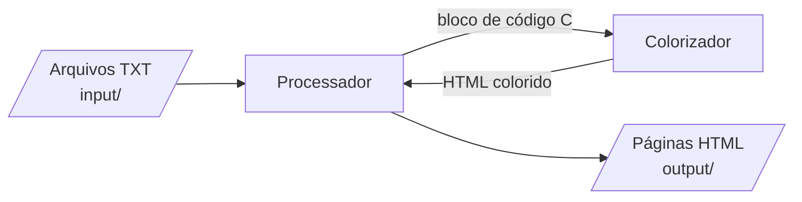
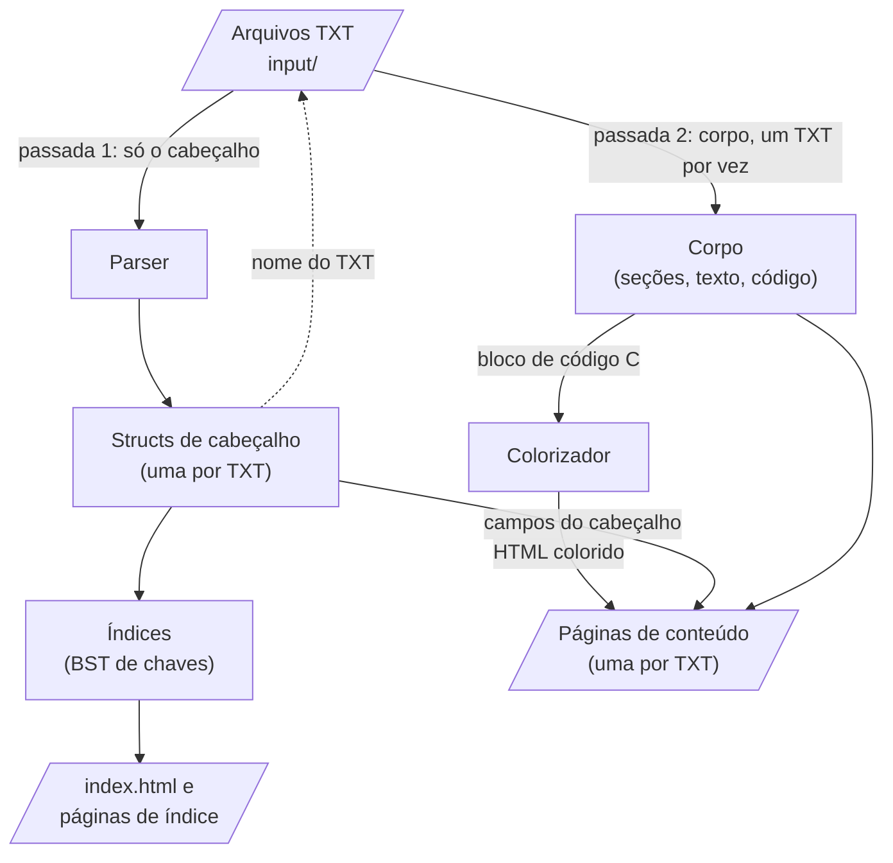
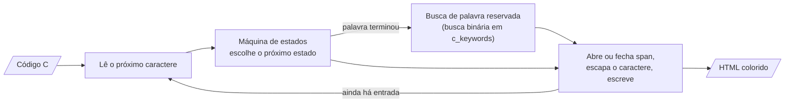
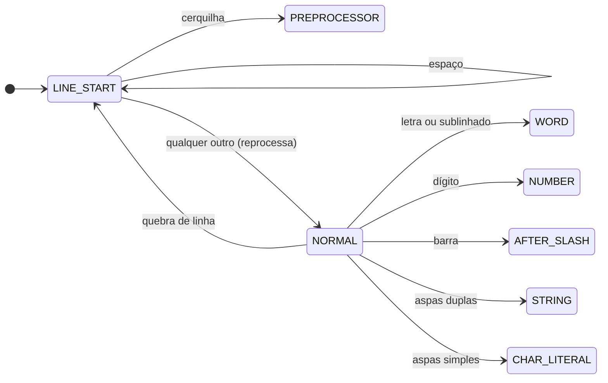
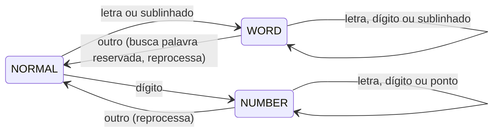
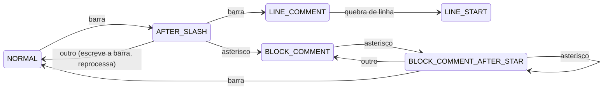
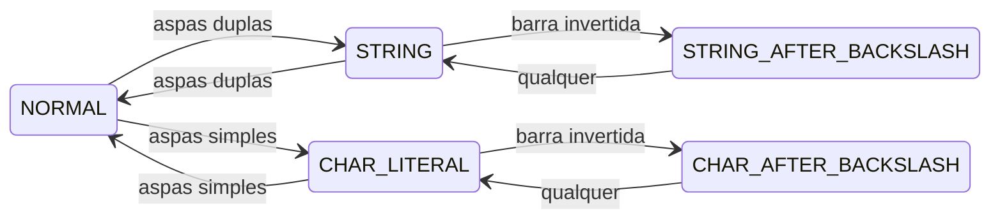
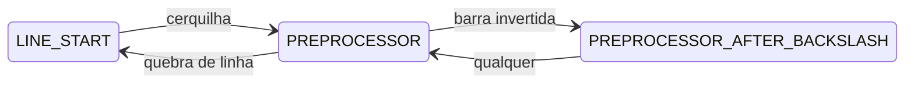

[English](README.md)

# mac0122

Ferramentas e soluções para a disciplina MAC0122.

EP1: um programa em C89 que lê arquivos TXT com o conteúdo da
disciplina e gera um site HTML estático, com cada bloco de código C
destacado (*syntax highlighting*).

## Fluxo básico



1. O **processador** lê cada arquivo TXT de `input/`.
2. Cada bloco de código C de um TXT é enviado ao **colorizador**.
3. O colorizador devolve o código como HTML colorido.
4. O processador grava as páginas HTML em `output/`.

## Dentro do processador



1. **Passada 1.** O parser lê apenas o cabeçalho de cada TXT e monta
   uma struct de cabeçalho por arquivo. Cada struct guarda o nome do
   seu TXT.
2. **Índices.** As structs de cabeçalho montam os seis índices. Cada
   índice aponta para structs de cabeçalho; nunca as copia.
3. **Páginas de índice.** `index.html` e as páginas de índice (uma por
   índice e ordenação) são geradas a partir dos índices.
4. **Passada 2.** Para cada struct de cabeçalho, o processador reabre o
   seu TXT, pula o cabeçalho e lê o corpo. Os blocos de código passam
   pelo colorizador. A página de conteúdo é gerada a partir da struct
   de cabeçalho (topo da página) e do corpo (o restante), e o corpo é
   liberado.

## Modelo de dados

### Cabeçalho e corpo

Cada TXT tem um cabeçalho (as linhas antes de `---`) e um corpo (o
restante). Eles são tratados de formas diferentes:

- **Cabeçalho**: lido uma única vez, na passada 1, para uma struct de
  cabeçalho por TXT. A struct guarda os campos do cabeçalho (técnica,
  algoritmo, autores, data, conceitos, problema) e os nomes do TXT e do
  HTML. Autores e conceitos são listas, pois um TXT pode citar vários.
  Todas as structs de cabeçalho ficam na memória até o fim da execução.
- **Corpo**: lido na passada 2, um TXT por vez. A passada 2 pula o
  cabeçalho (ele nunca é lido duas vezes), gera a página e libera o
  corpo antes de passar para o próximo TXT.

O pico de memória é, portanto, todos os cabeçalhos mais o maior corpo.

| Página | Gerada a partir de |
|---|---|
| `index.html` e as páginas de índice | só as structs de cabeçalho, por meio dos índices |
| uma página de conteúdo por TXT | sua struct de cabeçalho (topo da página) e o corpo do seu TXT (o restante) |

### Índices

Um índice associa uma chave (um conceito, um autor, ...) às páginas
que a citam. Cada índice é uma árvore binária de busca (BST) de
chaves; cada nó da BST guarda uma lista ordenada de ponteiros para
structs de cabeçalho:

```
            "grafos" ──► [Kruskal, Prim]
           /        \
"arvores" ──► [Kruskal, Prim]    "union-find" ──► [Kruskal]
                                /
                       "heap" ──► [Prim]
```

- Autores e conceitos podem ter vários valores; técnica, algoritmo e
  data têm exatamente um. Cada valor de um campo com vários valores
  vira uma chave própria, então uma página pode aparecer sob várias
  chaves.
- As chaves são normalizadas (minúsculas, sem acentos) antes de serem
  comparadas, então "Árvores" e "árvores" ficam no mesmo nó. As
  páginas de índice mostram a chave normalizada.
- Datas são escritas como `dd/MM/AAAA` ou `AAAA` e são comparadas como
  datas, não como texto. Uma data só com o ano vem antes de qualquer
  data completa do mesmo ano (`1956` vem antes de `12/03/1956`).
- A chave do índice de problemas é a frase inteira do problema,
  normalizada. Páginas só ficam sob a mesma chave quando os seus TXTs
  usam a mesma frase. Os TXTs são escritos pelo professor, então o
  formato fica como está.
- Os índices apontam para as structs de cabeçalho e nunca as copiam.
  O `main` é dono das structs de cabeçalho; os índices só as usam
  emprestadas.
- Um percurso em ordem (*in-order*) da BST lista as chaves em ordem
  (alfabética, ou por data no índice de datas), que é a ordem de que
  uma página de índice precisa.

As duas direções ficam guardadas: chave → páginas (a lista em cada nó
da BST) e página → chaves (as listas de autores e conceitos em cada
struct de cabeçalho). Juntas, páginas e chaves formam assim um grafo
bipartido guardado como listas de adjacência, com a BST como a busca
do nome de uma chave até o seu nó.

### Ordenação das páginas dentro de uma chave

O leitor escolhe como as páginas de cada chave são ordenadas, por meio
de links no topo da página de índice.

- As ordenações são os atributos do cabeçalho com valor único:
  algoritmo, técnica, data e problema. Um índice não oferece o seu
  próprio atributo, pois todas as páginas de uma mesma chave têm o
  mesmo valor nele (o índice de técnicas oferece algoritmo, data e
  problema).
- Autores e conceitos não são oferecidos: uma página pode ter vários
  deles, então não tem uma posição única na ordem.
- Cada ordenação é uma página separada, gerada de antemão (por exemplo
  `concepts_by_date.html`), então o site não precisa de JavaScript.
- Empates são desfeitos pelo nome do arquivo TXT, que é único, então
  toda ordenação é completa e igual em toda execução.

## Colorizador

O colorizador é um filtro: entra código C, sai HTML colorido. Ele é
usado de duas formas:

- como função, chamada pelo processador para cada bloco de código;
- como programa independente em `tools/`, lendo a entrada padrão e
  escrevendo na saída padrão.

Assinatura proposta (ainda não acordada pelo grupo):

```c
void c_highlighter_write_html(FILE *source_file, FILE *html_file);
```

Ele trabalha em fluxo: lê um caractere por vez e guarda apenas o
estado atual e a palavra atual, então um bloco de código nunca precisa
caber inteiro na memória.

### Como funciona



1. Lê um caractere do código.
2. A máquina de estados usa o estado atual e esse caractere para
   escolher o próximo estado.
3. Se uma palavra acabou de terminar, procura-a no vetor de palavras
   reservadas para decidir o seu estilo.
4. Abre ou fecha um `<span>` quando o estilo muda, escapa o caractere
   para HTML e o escreve.
5. Repete até o fim da entrada e então fecha qualquer span aberto.

### Máquina de estados

O colorizador é uma máquina de estados finita. O estado atual diz
dentro do que o leitor está (uma string, um comentário, ...); alguns
caracteres o levam a outro estado. Entrar em um estado com estilo abre
um `<span class="...">`; sair dele fecha o span.

Construções que precisam de dois caracteres (`/*`, `*/`, `//`, `\"`)
usam estados intermediários ("acabou de ver uma barra", "acabou de ver
um asterisco") em vez de espiar o próximo caractere.

A máquina está desenhada em cinco partes abaixo. Em todas elas, uma
transição que não está desenhada mantém o estado atual e escreve o
caractere como está. "Reprocessa" significa que o caractere que
encerrou um estado não é consumido: o próximo estado o trata de novo.
Por exemplo, em `x+1` o `+` encerra a palavra `x` e depois é escrito
por `NORMAL`.

#### 1. Início de linha e código normal

Toda construção começa aqui.



`LINE_START` existe por causa do pré-processador: `#` só inicia uma
diretiva quando é o primeiro caractere não branco da linha.

#### 2. Palavras e números



Uma letra só diz que uma palavra começou. `WORD` junta as letras;
quando a palavra termina, uma busca binária no vetor ordenado de
palavras reservadas (`c_keywords`) decide o seu estilo. O conjunto de
palavras reservadas é fixo, então um vetor ordenado é mais adequado
que uma BST.

#### 3. Comentários



Uma `/` sozinha é divisão, então `AFTER_SLASH` espera um caractere
antes de decidir. Comentários `//` são tratados mesmo este projeto
sendo C89: os blocos de código dos TXTs são do professor, não nossos.

#### 4. Strings e literais de caractere



Os estados `*_AFTER_BACKSLASH` pulam um caractere escapado, então `\"`
não encerra uma string e `'\''` é um único literal de caractere.

#### 5. Diretivas do pré-processador



Uma barra invertida antes da quebra de linha continua a diretiva na
linha seguinte.

#### Estilos

| Estado | Estilo |
|---|---|
| `LINE_START`, `NORMAL`, `AFTER_SLASH` | nenhum |
| `WORD` | palavra reservada se a palavra for reservada em C; senão, nenhum |
| `NUMBER` | número |
| `STRING`, `STRING_AFTER_BACKSLASH`, `CHAR_LITERAL`, `CHAR_AFTER_BACKSLASH` | string |
| `LINE_COMMENT`, `BLOCK_COMMENT`, `BLOCK_COMMENT_AFTER_STAR` | comentário |
| `PREPROCESSOR`, `PREPROCESSOR_AFTER_BACKSLASH` | pré-processador |

- **Todo caractere escrito passa pelo escape HTML compartilhado**
  (`<`, `>`, `&`), inclusive dentro de strings e comentários.
- **No fim da entrada**, um span aberto é fechado, então uma string ou
  um comentário sem fim ainda gera HTML válido.

## Trabalhos futuros

- Visualização do site como grafo: páginas e chaves como nós, ligadas
  quando uma página cita uma chave. O modelo de dados acima já contém
  esse grafo; falta apenas desenhá-lo. Não faz parte da fase 1.
