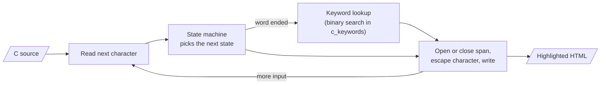
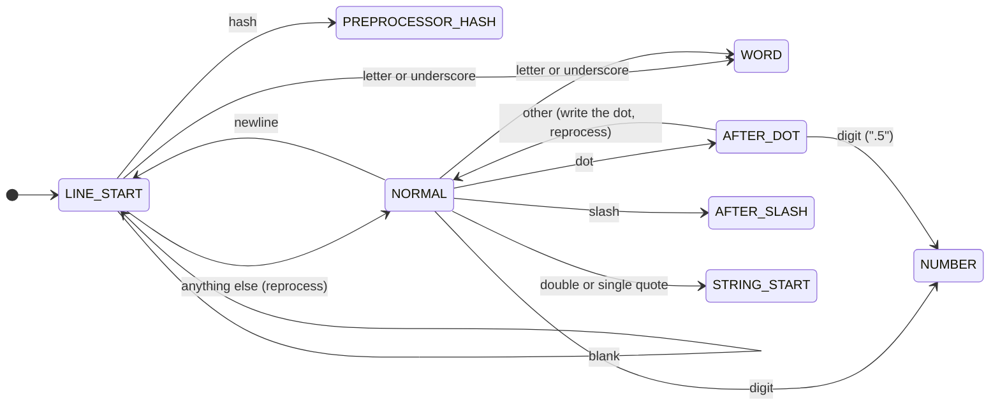
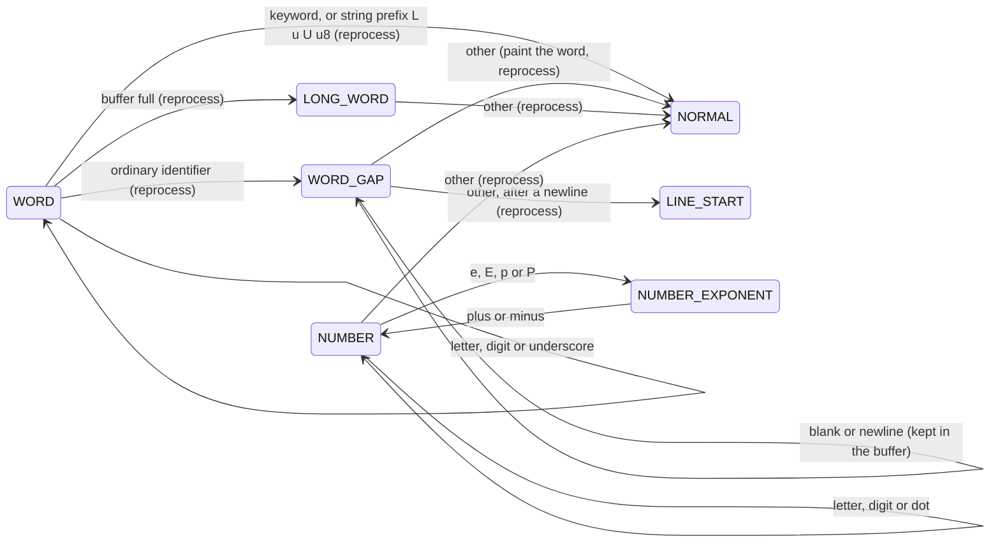
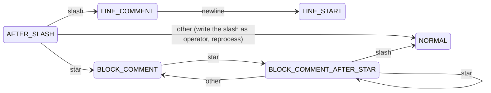
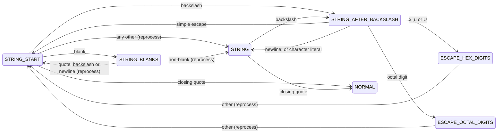
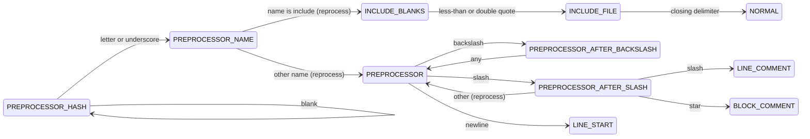

<!-- Replaces the whole "## Highlighter" section of README.md (up to "## Future work").
     README.pt-BR.md must receive the same change in the same commit. -->

## Highlighter

The highlighter is a filter: C source in, highlighted HTML out. It is
used in two ways:

- as a function, called by the processor for each code block;
- as a standalone program in `tools/colorir.c`, reading a file or
  standard input and writing standard output.

Signature (still to be agreed by the group):

```c
void c_highlighter_write_html(FILE *source_file, FILE *html_file);
void c_highlighter_write_css(FILE *css_file);
```

It streams: it reads one character at a time and keeps only the current
state, a few flags and one small buffer, so a code block never has to
fit in memory. Carriage returns are dropped, so Windows files give the
same HTML.

Every source line is written as `<span class="l">...</span>`; the CSS
draws the line number with a counter, so the number is not copied with
the code. A style span is opened only when a character is written and
is closed and reopened at every newline, so adjacent characters with
the same style share one span.

### How it works



1. Read one character from the source.
2. The state machine uses the current state and that character to pick
   the next state.
3. If a word just ended, look it up in the keyword array to decide its
   style.
4. Open or close a `<span>` when the style changes, escape the
   character for HTML, and write it.
5. Repeat until the end of input, then close any open span.

### State machine

"Reprocess" means the character that ended a state is not consumed: the
next state handles it again. A transition that is not drawn keeps the
current state. End of input is handled like any other character by the
states that still hold unwritten characters (`WORD`, `WORD_GAP`,
`AFTER_DOT`, `AFTER_SLASH`, `STRING_BLANKS`, `STRING_AFTER_BACKSLASH`,
`PREPROCESSOR_AFTER_SLASH`, `PREPROCESSOR_AFTER_BACKSLASH`), so they
flush; the other states just stop.

Besides the state, the machine keeps: the brace depth, the kind of the
previous token (type-like, `struct`/`union`, other), whether a `case`
label is open, the closing delimiter of the current string or file
name, and the buffer.

#### 1. Line start and normal code



`LINE_START` exists for the preprocessor (`#` starts a directive only
as the first non-blank character of a line) and for labels (`end:` is a
label only as the first word of a line). Operators (`~ ! % ^ & * + = |
? : < > -`) are written in `NORMAL` with the operator style; `( ) [ ] {
} , ; .` stay plain. `{` and `}` change the brace depth.

#### 2. Words and numbers



An ordinary identifier is painted only when the next significant
character is known, so `WORD_GAP` holds the word and the blanks after
it in the same buffer:

- followed by `(`, at brace depth 0, after a type: function name;
- after `struct` or `union`, followed by `{`: structure name;
- first word of a line, inside braces, followed by `:`: label (the
  colon is written plain).

Keywords are decided without looking ahead, by binary search in the
sorted array of `c_keywords`.

#### 3. Comments



A block comment that started inside a directive returns to
`PREPROCESSOR` instead of `NORMAL`.

#### 4. Strings and character literals



Strings and character literals share these states; the closing quote
is the stored delimiter. In a string, escapes get their own style; in a
character literal the whole literal has the string style. A run of
blanks made only of blanks between two quotes or escapes is written
without style, so `STRING_START` sends a blank run to `STRING_BLANKS`
until it knows what ends the run. A newline in a string ends it
(unterminated string).

#### 5. Preprocessor directives



For `#include`, only the directive word has the preprocessor style; the
file name has its own style and the rest of the line is normal code. For
any other directive, the whole line has the preprocessor style, up to a
comment. A backslash before a newline continues the directive.

#### Styles

| Style (CSS class) | Used for |
|---|---|
| `pragma` | directive line, or only `#include` |
| `arquivo` | file name after `#include` |
| `coment` | `//` and `/* */` comments |
| `tipo` | type words (`int`, `size_t`, `FILE`, `uint8_t`, `bool`, ...) |
| `comando` | other reserved words (`if`, `struct`, `static`, ...) |
| `builtin` | `true`, `false`, `NULL` |
| `funcao` | function name in a definition or prototype, not in a call |
| `estrutura` | name in `struct NAME {` and `union NAME {` |
| `rotulo` | label definition (`end:`), not `goto end` |
| `string` | strings, character literals, prefixes `L u U u8` |
| `escape` | escape sequences inside strings |
| `numero` | numeric literals |
| `operador` | operators |

- **Every character written goes through the shared HTML escape**
  (`<`, `>`, `&`), inside strings and comments too.
- **At end of input**, an open span and an open line are closed, so an
  unterminated string or comment still produces valid HTML.
